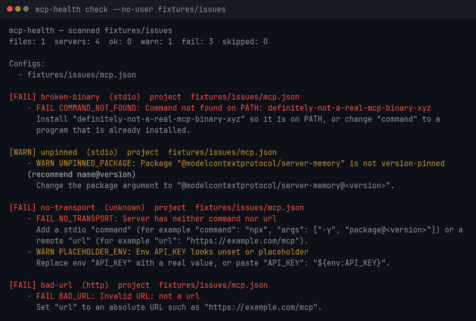

# mcp-health

CLI and GitHub Action that scans MCP (Model Context Protocol) server configs and reports **broken entries, missing commands, bad URLs, placeholder env vars, unpinned packages, npm drift, and optional initialize and tools/list probes**.

Catch rotten MCP configs before agents fail on them.

## Demo

Real `mcp-health check --no-user` output. The first run is `fixtures/issues` (exit 2). The second is `fixtures/healthy` (exit 0). The checkout path is shown as the fixture directory. After `npm run build`, regenerate it with `python3 scripts/render-demo-gif.py` (needs Pillow and a monospace font).



## Install

Node.js 20 or newer.

The npm package name is `@leon-pixel/mcp-health`. The unscoped name `mcp-health` was published by someone else and then unpublished, so npm will not let this project use it. The command name is still `mcp-health`.

From a checkout of this repository:

```bash
npm install
npm run check -- --no-user fixtures/healthy
```

From npm, once a maintainer has published a release (see [Releases](#releases)):

```bash
npm i -g @leon-pixel/mcp-health
mcp-health check .
```

```bash
npx @leon-pixel/mcp-health check .
```

## Usage

```bash
npm run check -- .
npm run check -- --no-user fixtures/issues
npm run check -- --no-user --online fixtures/healthy
npm run check -- --no-user --probe --probe-timeout 5000 fixtures/probe-ok
npm run check -- --no-user --probe --no-tools fixtures/probe-ok
npm run check -- --no-user --sarif mcp-health.sarif fixtures/issues
npm run check -- --no-user --github-annotations fixtures/issues
npm run check -- --no-user --json fixtures/healthy
npm run check -- --no-user -f path/to/mcp.json .
```

### Exit codes

| Code | Meaning |
|------|---------|
| `0` | All ok |
| `1` | Warnings only |
| `2` | Failures |

`--sarif` and `--github-annotations` do not change the exit code. They add a SARIF file and stderr annotations beside the usual report. Ok findings are left out of both.

## GitHub Action

```yaml
name: mcp-health
on: [push, pull_request]
jobs:
  check:
    runs-on: ubuntu-latest
    steps:
      - uses: actions/checkout@v4
      - uses: leon-pixel/mcp-health@v1
        with:
          path: .
          args: --no-user
```

`v1` is a moving tag. The [release workflow](.github/workflows/release.yml) points it at the latest stable `v1.x.y` release. It is not on the repository yet: the only tag today is `v1.0.0`, and that commit does not include the fixes in 1.1.0 or the checks in 1.2.0. `package.json` on this branch is `1.2.0`. After that version is tagged, `leon-pixel/mcp-health@v1` tracks it. Until a tag newer than `v1.0.0` exists, pin an immutable release or a commit SHA.

The action is not listed on the GitHub Marketplace. Install it from this repository.

Annotations are on by default (`::error` and `::warning` in the job log). A SARIF 2.1.0 file is written to `mcp-health.sarif` unless `sarif-file` is `false`. Uploading that file to code scanning is off unless you opt in. The upload needs `security-events: write` on the job, and the repository has to have code scanning enabled.

```yaml
permissions:
  contents: read
  security-events: write
steps:
  - uses: actions/checkout@v4
  - uses: leon-pixel/mcp-health@v1
    with:
      args: --no-user
      annotations: true
      sarif-file: mcp-health.sarif
      upload-sarif: true
```

The check step itself exits 0 so the upload can still run after findings. A following step exits with the real mcp-health code, so the job still fails on warnings and failures. The `exit-code` output is that code (`0`, `1`, or `2`).

Optional `args`: `--online`, `--probe`, `--no-tools`, `--probe-timeout 8000`, `--json`.

## What it scans

**Project** (a missing file is skipped):

| Client | Path | Shape |
|--------|------|--------|
| Cursor | `.cursor/mcp.json`, `mcp.json`, `.mcp.json` | `mcpServers` |
| VS Code | `.vscode/mcp.json` | `servers` |
| Claude Code | `.claude/settings.json`, `.claude/settings.local.json` | `mcpServers` |
| Windsurf | `.windsurf/mcp_config.json` | `mcpServers`. Remote URLs may be `serverUrl` or `url` |
| Zed | `.zed/settings.json` | `context_servers`. `command` may be a string or `{ "path", "args", "env" }` |
| Codex | `.codex/config.toml` | `[mcp_servers.<name>]` with `command`, `args`, `url`, `env`, `http_headers` |

A Codex `config.toml` or a settings file with no MCP section is skipped. It is not a failed scan.

**User-level** (disable with `--no-user`):

- Cursor `~/.cursor/mcp.json`
- Claude Code `~/.claude/settings.json`
- Claude Desktop `claude_desktop_config.json`
- Windsurf `~/.codeium/windsurf/mcp_config.json`
- Devin Desktop `mcp_config.json` under `$XDG_CONFIG_HOME/devin/` (default `~/.config/devin/`), or `%APPDATA%/devin/` on Windows
- Zed `settings.json` under `$XDG_CONFIG_HOME/zed/` on Linux, plus `~/Library/Application Support/Zed/settings.json` and `~/.config/zed/settings.json` on macOS, or `%APPDATA%/Zed/settings.json` on Windows
- Codex `~/.codex/config.toml`

## Checks

- Offline: JSON and TOML shape, PATH (including Windows `PATHEXT`), URLs, pins, placeholders
- Config variables: `${workspaceFolder}`, `${userHome}`, `${pathSeparator}`, and `${env:NAME}` are expanded. `${input:…}` and anything else still in the config fail the server instead of being reported healthy
- `--online`: npm latest vs the pinned version or semver range (`NPM_DRIFT` only when latest is outside the pin)
- `--probe`: MCP handshake from the project root (stdio spawn, or HTTP POST with the config's headers). Stdio matches the JSON-RPC id and skips logs and notifications. HTTP accepts a JSON body or a Streamable HTTP SSE response. Env values are never printed
- After a successful handshake, `--probe` also calls `tools/list`. One or more tools is `TOOLS_OK`. An empty list is a warning, `EMPTY_TOOLS`, not a failure and not `HEALTHY`. A tools/list error or timeout is a warning, `TOOLS_LIST_FAILED`. `--no-tools` skips that call

The initialize request uses protocol revision `2025-11-25`. If the server rejects that method, the probe tries `server/discover` on `2026-07-28`, then `tools/list` on that same revision.

## How this differs from Inspector and other health tools

mcp-health reads the MCP config files already in a repo (and, unless you pass `--no-user`, the user-level files above) and reports whether those entries will load: missing commands, bad URLs, unpinned packages, optional registry drift, and an optional handshake that includes `tools/list`. The GitHub Action is the CI form of that scan, with annotations and SARIF.

[MCP Inspector](https://github.com/modelcontextprotocol/inspector) (`@modelcontextprotocol/inspector`) is the interactive debugger for one server you already know how to start. Its web, CLI, and TUI clients connect to that server so you can inspect and call tools, resources, and prompts. It does not scan Cursor, VS Code, Claude, Windsurf, Zed, or Codex config files.

[MCP Doctor](https://mcpdoctor.ai/) (`npx mcpdoctor test …`) grades one server command against the MCP spec. [mcp-healthcheck](https://github.com/SiluPanda/mcp-healthcheck) is a liveness probe for one server URL or stdio command, including Kubernetes-style checks. mcp-health does not call tools, score spec compliance, or watch a running server. It checks the configs an agent will load.

## Example

```text
[FAIL] broken-binary  (stdio)
    - FAIL COMMAND_NOT_FOUND: ...
[WARN] unpinned  (stdio)
    - WARN UNPINNED_PACKAGE: ...
```

## Releases

Pushing a stable tag `vX.Y.Z` that matches `version` in `package.json` runs [`.github/workflows/release.yml`](.github/workflows/release.yml). That workflow:

1. Runs the test suite and build
2. Creates a GitHub Release
3. Moves the major tag (`v1` for a `v1.x.y` release) to that commit
4. Publishes `@leon-pixel/mcp-health` to npm when the repository secret `NPM_TOKEN` is set

`NPM_TOKEN` is an npm automation token that can publish the `@leon-pixel` scope. When the secret is absent, the workflow still cuts the GitHub Release and moves the major tag, and it skips npm publish.

The action is not published to the GitHub Marketplace by this workflow. Marketplace listing is a separate step on the GitHub release page.

## Tradeoffs

- The default scan is offline, so it is safe in CI
- `--probe` runs real processes. Do not point it at configs you do not trust
- IDE `PATH` can differ from the PATH in CI or a terminal
- `${input:…}` values are not prompted. They are reported as unresolved
- SARIF upload is opt-in because many repositories do not have code scanning

## Roadmap

See [ROADMAP.md](./ROADMAP.md) and [CHANGELOG.md](./CHANGELOG.md).

## License

MIT
